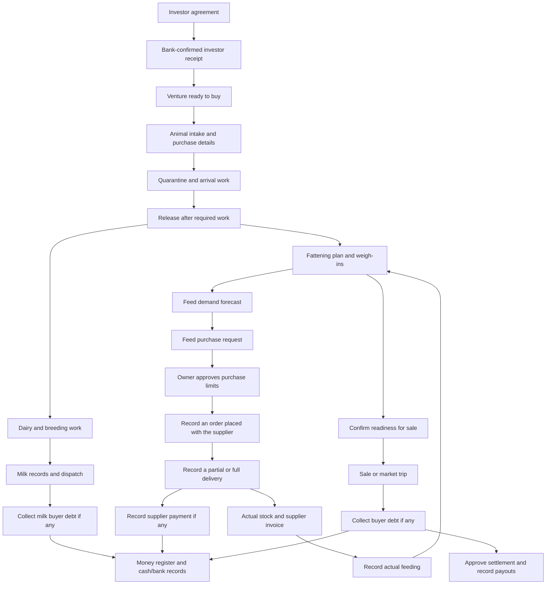

# OpenFarm user flow and clarity review

Reviewed: 12 October 2026.

The largest remaining problems are inconsistent meanings across screens, unclear differences between saved and accepted records, and missing explanations at workflow boundaries. The app already has substantial safeguards; the recommendations below clarify and connect those safeguards rather than replace the business rules.

## Follow-up implementation

The five P1 findings below were addressed after this audit. The finding descriptions preserve the original observations.

- **A01:** the dashboard and feed page share the same operational-shortage calculation. Empty unused items are excluded; exhausted feed in an assigned ration and configured low-stock alerts are included. The summary waits for the required queries and shows load failures.
- **A02:** completing work says it was kept on the phone. The work board and daily list show pending delivery, and claim guidance explains that the farm confirms ownership when the entry arrives.
- **A03:** milk reconciliation says there are no recorded discrepancies awaiting review, without claiming every milking was compared. Staff with no pen assignment see an explanation and a next step. Other empty work lists use neutral wording.
- **A04:** shared form sheets/dialogs and intake warn before navigation or reload. Intake text and agreement terms/nominees are recoverable on the same device, scoped to user, farm and agreement venture. Successful saves clear the draft; restored drafts can be discarded explicitly. Photos must be selected again, and storage failure is shown.
- **A05:** milk dispatch and feeding-plan validation provide a specific explanation and a field to focus, including zero quantities, overpayment, invalid dates, missing rations and coverage problems.

Validation includes automated regression tests for stock rules, draft recovery/isolation/storage failure, milk and plan validation, and work delivery notices. Browser checks confirm matching dashboard/feed shortage counts, intake navigation protection/recovery/discard, milk validation focus, and neutral reconciliation wording. The preview farm has no animal or agreement fixtures; their remaining paths were checked through code and shared behavior tests, without creating business records.

## Scope and method

- Traced the routes, role navigation, forms, success messages, domain calculations, and selected API state transitions for the owner, manager, staff, vet, and investor journeys.
- Inspected the running app as the signed-in owner, including the dashboard, animals, feed purchasing, milk reconciliation, and money pages.
- Reproduced the stock-count inconsistency, the milk form's generic validation error, and the financial date range resetting on reopening.
- Other findings are source-confirmed behavior or a stated usability risk. Staff, vet, and investor accounts were traced through their code paths; they were not impersonated in the browser. Destructive actions, clinical outcomes, phase transitions, and financial writes were not submitted.
- The four clarity improvements from the preceding task are included in the reviewed working tree and are not counted as unresolved findings: outbox removal wording and confirmation, separate rejection/review counts, advance payments included in monthly totals, and receiving feed against an order.
- Application code was left unchanged during this review. This document is the review artifact. No new farm records were created.

Priorities: **P1** should be addressed first because users can misunderstand an operational result, lose entered work, or struggle to correct an invalid entry. **P2** affects workflow handoffs, action consequences, or report interpretation. **P3** is navigation or wording polish.

## Workflow coverage

| Area | Flow traced | Assessment |
| --- | --- | --- |
| Sign-in and onboarding | Personal account / shed phone PIN / investor invitation → correct landing → farm setup | Separate doors and wrong-address recovery are explicit. Setup prerequisites need to remain visible to users who see empty work lists. |
| People and access | Invite → role → pen or clinical case scope → PIN/access → training | Pen assignment and training are distinct. A staff member's empty work screen does not explain missing pen assignment. |
| Playbook | Draft → propose/publish → immutable version → scheduled/event/manual work → training | Draft recovery and navigation protection are strong. Existing work keeps its version and shows version changes. |
| Daily work and offline delivery | Start → record evidence → save locally → transmit → acceptance/review/rejection → sign-off/correction | Local completion and the farm's receipt still need different wording. |
| Observations and health | Report sighting → vet/manager follow-up → diagnosis → prescription → dose work → outcome | The chain exists. Auxiliary read failures and one-tap outcomes need attention. |
| Breeding | Heat → service work → pregnancy check → expected calving → calving/offspring → repeat breeder review | History links to originating work. Decisions and actual animal state changes are kept apart. |
| Animal acquisition and lifecycle | Buying trip → intake → quarantine → arrival doses/release → dairy/fattening → exit | Intake collects purchase details; the generic registration door can be mistaken for the same flow. |
| Fattening and feed plans | Arrival weight → approved plan → weigh-ins → recalculated forecast → ration review → sale target | Forecast assumptions and actual pen ration changes need a clearer handoff. |
| Feed and stock | Ingredients → rations → pen assignments → feeding → stock/leftovers/counts → estimates | The same stock-shortage label currently uses different definitions on the dashboard and feed page. |
| Purchasing and suppliers | Request → owner approval → placed order → partial delivery → invoice → supplier payment → correction | Requests, promised deliveries, actual stock, and supplier debt are separated. The recent receiving choice closes an important entry-route ambiguity. |
| Milk | Cow records → tank reading → mismatch investigation → dispatch → buyer debt/payment → registers | No flagged sessions is presented too positively when there are no readings. Dispatch validation and time parsing need attention. |
| Sales and trips | Suggestions → confirmed ready → direct sale / market trip → papers → buyer debt collection | Suggested readiness and confirmed readiness are separate, with a route from an empty sales list to suggestions. |
| Money, cash, and wages | Automatic/manual record → owner review when required → cash/bank custody → wage advances/debts → reconciliation | Recorded-money approval has a different meaning from pre-purchase approval. Reporting date state is not reliably preserved. |
| Ventures and settlement | Open with plan → agreements → confirmed capital → buying float/intakes → fattening/sales → bank checks → frozen settlement → payouts/acknowledgments/adjustments | Phase changes deserve consequence summaries. Settlement approval and actual payouts are already separate. |
| Investor portal | Invite/consent → request → agreement/approval → pay-in notice → bank-confirmed receipt → progress → payout → document history | Pending notices do not count as confirmed capital. Signed originals, current/previous nominations, and generated statements are distinguished. Preview has an explicit band and disabled investor actions. |
| Reports and administration | Monthly/annual results → estimates/actual returns → inspector registers/letters → audit → settings/backups | Period and clock consistency affect interpretation. Backup states and register exports already have specific wording. |

## How the main flows connect

These are connected records, not all automatic actions. Placing a supplier order and moving money happen outside the app; the app records them. A feed plan projects demand; it does not change the pen's feeding instructions by itself. Settlement approval freezes figures; it is not a bank transfer.

## Findings

### A01 · P1 · The owner dashboard and feed page disagree on running-low stock

**Browser-confirmed.** The dashboard showed **10** under “কমে আসছে”; the feed page showed **0** for the same stock. The dashboard counts every non-retired item classified as low or out. The feed page also considers whether an empty item is used by an assigned ration or explicitly watched.

**User impact:** opening the detailed page appears to make shortages disappear. Users cannot tell whether to purchase feed or which number to trust.

**Recommendation:** use one shared definition everywhere, or explicitly distinguish “মজুত নেই” from “চলমান রেশনের ঘাটতি.” Ensure each count opens the exact list it counts.

Evidence: [dashboard stock calculation](../../apps/web/src/components/home/farm-panels.tsx#L419), [feed-page calculation](../../apps/web/src/routes/_authenticated/feed/route.tsx#L85), [stock standing](../../apps/web/src/components/feed/feed-types.ts#L69).

### A02 · P1 · Locally queued work can sound complete at the farm

**Source-confirmed.** Work completion writes through the offline outbox and immediately shows either “শেষ হয়েছে” or “শেষ — অনুমোদনের অপেক্ষায়.” Those words do not distinguish a durable local entry from one the server has accepted. The claim hint also says that taking the work prevents anybody else from recording it, which the farm cannot establish until an offline claim reaches it.

**User impact:** staff may believe the manager has received their work, or that an offline claim has reserved it exclusively, while transmission is still pending.

**Recommendation:** distinguish “ফোনে কাজ সংরক্ষিত,” “খামারে পৌঁছেছে,” and “যাচাই/অনুমোদন বাকি.” Keep the business completion state separate from delivery state, and say that an offline claim is awaiting the farm's confirmation. A global sync count is useful but cannot identify which particular work item is affected.

Evidence: [work completion success](../../apps/web/src/routes/_authenticated/work/$instanceId.tsx#L127), [completion wording selection](../../apps/web/src/components/work/work-types.ts#L21), [claim wording](../../packages/i18n/src/messages/bn-core.ts#L3229).

### A03 · P1 · An empty result can be mistaken for a successful check

**Browser-confirmed for milk; source-confirmed risk for staff work.** Milk reconciliation says “সব ট্যাংকের হিসাব গাভীদের সঙ্গে মিলেছে” when the flagged-session list is empty, including a farm with no milk readings to compare. The staff work list similarly uses a completed-looking empty state and says the next work will arrive later; it does not distinguish an empty assignment from no outstanding work.

**User impact:** “nothing recorded” and “everything checked” can look equivalent. An unassigned worker may wait instead of asking a manager to assign pens.

**Recommendation:** distinguish no inputs, no assignments, no matches under the selected scope, and a genuinely completed check. For milk with no comparison data, use “তুলনা করার মতো দোহনের তথ্য নেই.” For missing staff assignments, name the manager as the next contact.

Evidence: [milk empty state](../../apps/web/src/components/milk-mismatches.tsx#L327), [work empty state](../../apps/web/src/routes/_authenticated/work/index.tsx#L415), [pen-assignment explanation](../../apps/web/src/components/people/person-access.tsx#L449).

### A04 · P1 · Unfinished forms have inconsistent protection when leaving

**Source-confirmed.** Shared sheets and dialogs ask before closing a changed form through their own controls, but do not block browser navigation or reload. Intake and agreement values live in React state. The playbook editor already has a stronger pattern: a recoverable draft and a router/unload guard.

**User impact:** after entering an animal's buying details or an agreement's terms, browser Back, reload, or navigation can discard that work. Some sheets retain values in memory after closing, but that retention is lost on reload; it is not a durable saved draft.

**Recommendation:** reuse the playbook's navigation protection for substantial forms. Add recoverable drafts where entry takes time, and make “keep draft,” “discard draft,” and “save the record” separate meanings. Keep drafts scoped to the person using the device.

Evidence: [sheet closing guard](../../apps/web/src/components/page-kit.tsx#L869), [intake state](../../apps/web/src/routes/_authenticated/intakes.tsx#L66), [agreement state](../../apps/web/src/components/ventures/sign-agreement-sheet.tsx#L733), [working draft-protection pattern](../../apps/web/src/components/playbook/sop-draft-keeping.tsx#L22).

### A05 · P1 · Some validation failures do not tell users what to fix

**Browser-confirmed.** In the milk dispatch form, 0 litres, a positive price, and a buyer name satisfy the native input constraints but fail the custom readiness check. Submitting shows only “এর যা যা লাগে তার সবকিছু এখনো দেওয়া হয়নি.” No incorrect field is identified or focused. No dispatch was submitted during this check. Feed-plan coverage failures also calculate problems without passing a specific missing-field explanation to the shared form.

**User impact:** the save button appears unresponsive, and users may repeatedly change unrelated information.

**Recommendation:** every custom readiness rule should produce a field and an actionable explanation. For this case: “দুধের পরিমাণ ০-এর বেশি দিন.” For a plan, name the uncovered weight range, invalid date, or missing ration. Align input bounds with the accepted business values.

Evidence: [milk readiness](../../apps/web/src/components/milk/dispatch-sheet.tsx#L132), [generic form fallback](../../apps/web/src/components/page-kit.tsx#L861), [feed-plan validation](../../apps/web/src/components/animal/feeding-plan-tab.tsx#L140).

### A06 · P2 · Venture phase changes happen without a consequence summary

**Source-confirmed.** Starting buying and starting fattening call mutations directly. Their buttons are appropriately gated, but there is no intermediate summary explaining how the next phase changes available actions. Other major venture actions use forms or confirmations.

**User impact:** a stray tap can move the venture into a phase where new agreement offers or buying actions behave differently, even though the farm's prerequisite checks pass.

**Recommendation:** show the venture, current and next phase, and the important consequences before changing phase. The confirmation should describe the existing rule, not introduce a new approval layer.

Evidence: [direct phase mutations](../../apps/web/src/components/ventures/use-venture-acts.tsx#L89), [phase buttons and gates](../../apps/web/src/components/ventures/venture-card.tsx#L438), [capital acceptance by phase](../../packages/domain/src/monthly-sums.ts#L152).

### A07 · P2 · “Approval” means two different things in financial workflows

**Source-confirmed.** Feed purchasing approval authorizes quantity and spending before an order is placed. Money-register approval reviews an already recorded transaction: the entry is not held back, and totals include it while owner approval is pending. Both are described with “অনুমোদন.”

**User impact:** a manager or owner may assume pending money-register approval means the money has not yet entered the records, as it would for a proposed purchase.

**Recommendation:** identify the context explicitly: “কেনার আগে অনুমোদন” for purchasing, and “নথিভুক্ত লেনদেন — মালিকের যাচাই বাকি” for the money register. Show whether the figure already contributes to the displayed totals. Preserve the existing record-first policy.

Evidence: [record-first money policy](../../packages/api/src/money-store.ts#L914), [money totals](../../packages/api/src/money-store.ts#L365), [purchase states](../../packages/i18n/src/messages/bn-core.ts#L174), [money approval badge](../../apps/web/src/components/money/register.tsx#L134).

### A08 · P2 · Generic animal registration looks like the normal purchase entry point

**Source-confirmed usability risk.** The Animals page prominently offers “নতুন পশু নথিভুক্ত করুন.” Its form records identity, source, state, and pen, while the Intake flow collects purchase price, arrival weight, seller, journey, and ownership/payment details. The registration form has a helper explaining its alternative purpose, but that distinction appears only after opening it.

**User impact:** a user adding a newly bought animal can choose the most obvious button and omit the buying details that belong in intake.

**Recommendation:** offer a clear source choice before entry: bought now → Intake; already on the farm → opening/existing animal registration; born here → the calving/birth workflow. Keep the alternative registration form but give it a purpose-specific label.

Evidence: [registration action and payload](../../apps/web/src/components/register-animal.tsx#L72), [intake workflow](../../apps/web/src/routes/_authenticated/intakes.tsx#L46), [registration helper](../../packages/i18n/src/messages/bn-core.ts#L1509).

### A09 · P2 · The two feed-demand views can produce different answers without an obvious comparison

**Source-confirmed, intentionally different calculations.** The monthly estimate holds today's herd and ration rates constant. Feeding plans project changing weight and saved ration stages for planned fattening animals. Their treatment of future stock use and excluded animals also differs. The detailed explanations exist, but “মাসিক হিসাব” and “খাদ্য পরিকল্পনা” do not explain why their purchase quantities differ.

**User impact:** users may think the system is inconsistent or choose the wrong figure for a purchase request.

**Recommendation:** use explicit names such as “বর্তমান রেশনে মাসিক চাহিদা” and “ওজন বৃদ্ধিসহ খাদ্য পরিকল্পনা.” Put the month, included animals, basis, and major stock assumptions beside the quantity/cost summary, especially before creating a purchase request.

Evidence: [monthly-estimate assumptions](../../packages/i18n/src/messages/bn-core.ts#L2047), [plan-demand scope](../../apps/web/src/components/feed/feeding-plans.tsx#L115), [feeding-plan operational guidance](../runbooks/feeding-plans.md).

### A10 · P2 · Approving a feed plan does not visibly complete the handoff to actual feeding

**Source-confirmed usability risk.** Saving a plan stores a forecast; the pen's actual ration must be assigned separately. The helper states this correctly, and a later mismatch notice links to the general ration page. The user still has to connect the proposed animal ration, the actual pen, and the assignment action.

**User impact:** users can assume their newly approved plan is already what staff will feed, or get lost after following the broad ration link.

**Recommendation:** after saving or reviewing a stage, show “পরিকল্পনা সংরক্ষিত,” the current pen ration, the plan's proposed ration, and a specific next action for that pen. Keep actual ration changes deliberate; do not automatically apply a forecast.

Evidence: [plan-save explanation](../../packages/i18n/src/messages/bn-core.ts#L222), [ration-review handoff](../../apps/web/src/components/animal/feeding-plan-tab.tsx#L479).

### A11 · P2 · Clinical outcomes are recorded by a single tap

**Source-confirmed.** The recovered/not-recovered buttons immediately record the outcome. The API treats the first outcome as final for that action; changing it afterwards goes through a correction with a reason. This is stronger than the buttons' plain outline appearance suggests.

**User impact:** users can record the wrong clinical outcome accidentally, then have to discover the correction path.

**Recommendation:** confirm the animal, diagnosis, and selected outcome, or use an explicit outcome form with those details before recording. Make the correction route visible after recording. This recommendation concerns interface consequences, not a change to clinical rules.

Evidence: [outcome buttons](../../apps/web/src/components/animal/health-tab.tsx#L91), [outcome and correction semantics](../../packages/api/src/routers/diagnoses.ts#L235).

### A12 · P2 · Financial and milk date selections do not reliably survive reopening

**Browser-confirmed for money; source-confirmed for milk.** Changing the money range from 1 October to 1 September changed the query and visible date field but left the URL at `/money`. Reopening that address reset the range to 1 October. Milk's selected day is also held only in component state.

**User impact:** returning to a page, refreshing, or sharing its link can display a different period. Users comparing totals can mistakenly compare different dates.

**Recommendation:** persist report periods and the selected milk day in validated search parameters. Preserve them through tab navigation, and show the period on exports and summaries.

Evidence: [money date state](../../apps/web/src/routes/_authenticated/money/route.tsx#L125), [milk day state](../../apps/web/src/routes/_authenticated/milk/route.tsx#L99).

### A13 · P2 · Milk dispatch uses the phone's timezone for a typed historical time

**Source-confirmed conditional bug.** A manually entered dispatch timestamp goes through `new Date(form.dispatchedAt)`, interpreting a `datetime-local` value in the device's timezone. Intake, sales, and weigh-ins use the farm-clock conversion helper instead.

**User impact:** a phone configured outside the farm's timezone can record a dispatch at a different time or on a different farm day from the time the user typed.

**Recommendation:** use the farm-clock conversion for initial dispatch entry, verify its consistency with the correction path, and label date/time entry consistently. Verify with a device timezone different from the farm's, including a time near midnight.

Evidence: [dispatch timestamp parsing](../../apps/web/src/components/milk/dispatch-sheet.tsx#L147), [farm-clock helper](../../apps/web/src/lib/farm-moment.ts#L16), [sale timestamp conversion](../../apps/web/src/components/sale/sale-sheet.tsx#L445).

### A14 · P2 · Some detail queries hide failures as loading or an absent warning

**Source-confirmed.** The milk-session cow list shows a skeleton whenever no data exists, including a failed request. The arrival-dose warning builds an empty list from missing data and disappears while loading or on error. The server still enforces release rules; the issue is the missing explanation on the screen.

**User impact:** users may wait indefinitely for details, or see no dose warning and only learn of the problem when an action is refused.

**Recommendation:** represent loading, unavailable, stale, and genuinely empty data separately. Use the existing `Loaded`/retry pattern for detail reads, and say when a prerequisite could not be checked.

Evidence: [milk-session detail loading](../../apps/web/src/components/milk-mismatches.tsx#L39), [dose-warning read](../../apps/web/src/components/work/work-notices.tsx#L64), [shared loading/error pattern](../../apps/web/src/components/page.tsx#L638).

### A15 · P3 · The same task can have different language behavior on different screens

**Source-confirmed.** Today's work cards always display `content.name.bn`. The work board selects the English name when English is active and that name exists. Other labels on the list already follow the language setting.

**User impact:** a user selecting English can open a Bangla-named card and encounter the same procedure under its English name, making recognition less consistent.

**Recommendation:** use the same translated-name helper for the list, board, review queue, and training references, with Bangla as the fallback when no English name exists.

Evidence: [work-card title](../../apps/web/src/routes/_authenticated/work/index.tsx#L155), [work-board title selection](../../apps/web/src/components/work/work-board.tsx#L45).

### A16 · P3 · The animal no-match heading still sounds like an empty farm

**Source-confirmed wording issue.** The Animals page correctly computes a specific description for an unmatched tag or active filters. Its empty-state heading remains “এখানে এখনো কোনো পশু নেই” in all cases.

**User impact:** the heading can suggest records are missing even though the description says the selected filter has no matches.

**Recommendation:** vary the heading with the already computed state: no animals yet, no matching tag, or no animals in this filter. Keep the existing clear-filter action.

Evidence: [filter-aware descriptions](../../apps/web/src/routes/_authenticated/animals/index.tsx#L261), [unconditional empty heading](../../apps/web/src/routes/_authenticated/animals/index.tsx#L399).

## Recommended implementation order

1. **Make status and validation trustworthy:** A01, A02, A03, A05, A14. Share stock-shortage definitions, distinguish local/server states, avoid success wording without inputs, name validation problems, and expose failed prerequisite reads.
2. **Protect entered work and report context:** A04, A12, A13. Add navigation protection/draft recovery, preserve date ranges in the address, and align timestamp conversion.
3. **Clarify workflow handoffs:** A06, A07, A08, A09, A10, A11. Explain phase changes, the two meanings of approval, animal entry routes, estimate assumptions, actual ration assignment, and outcome recording.
4. **Finish wording consistency:** A15, A16. Reuse task-name selection and align empty headings with their descriptions.

For each change, verify the behavior after refresh, on a small phone, with a failed read, and with a user who does not have the next action's role. Avoid adding new business features until the existing workflow's next action is clear.

## Behaviors worth preserving

- Investor payment notices are explicitly unverified; confirmed receipt allocation is derived from the ledger, and partial advances reduce the correct future installment.
- Supplier promises do not become stock. Deliveries, supplier invoices, and actual payments remain separate records.
- Signed document history distinguishes current and previous nominations, signed-paper photos, in-app consent, and missing original copies.
- Investor preview names the person being previewed and prevents acting as them.
- Clinical permissions separate the vet's decisions from owner/manager administration and visiting-case scope.
- Corrections retain reasons, reject stale snapshots, and protect approved settlement figures through separate adjustments.
- Work versions are immutable, and staff see notices when work still uses an older version.
- The playbook's draft recovery, field-aware agreement validation, and shared query-error components provide existing patterns to reuse.

Review criteria included the [Web Interface Guidelines](https://raw.githubusercontent.com/vercel-labs/web-interface-guidelines/main/command.md), particularly actionable form errors, preservation of navigation state, and clear consequences for destructive actions. The findings themselves are grounded in the app's source and the browser observations described above.
